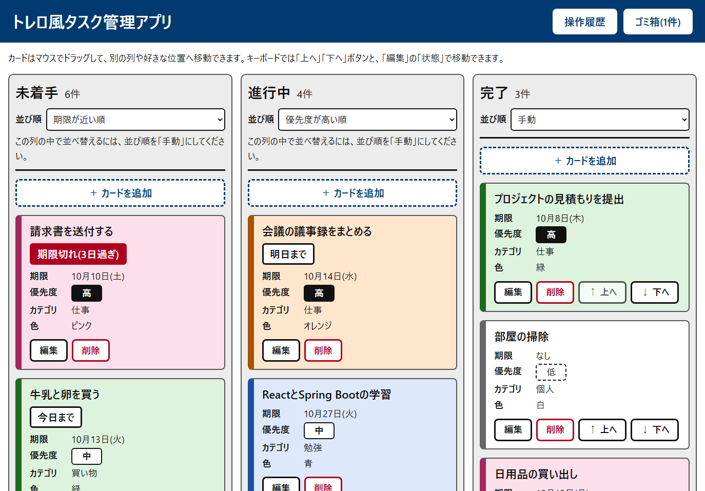
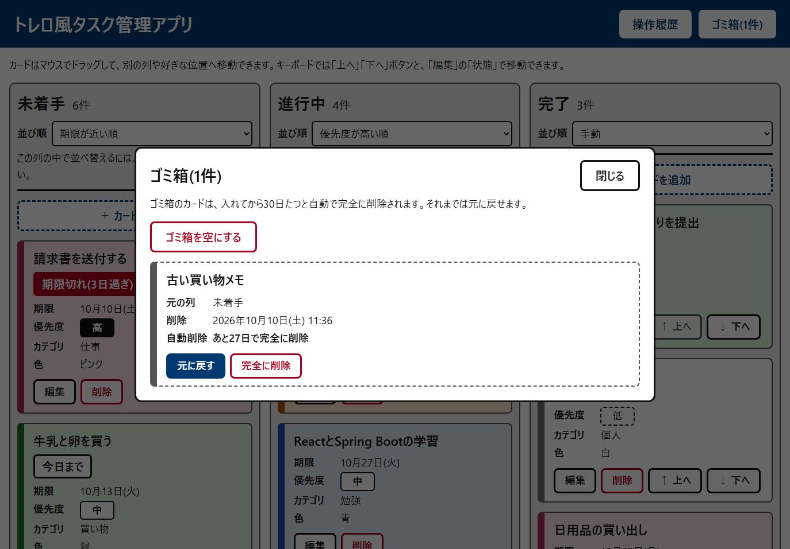

# トレロ風タスク管理アプリ

「未着手・進行中・完了」の3列のボードで、タスクをカードとして管理する Web アプリです。
視力の弱い人でも使いやすいよう、**大きな文字・高いコントラスト・色だけに頼らない表示・キーボードだけでの操作**を最初から考えて作っています。



## 主な機能

- **カードの管理**: 追加・編集・削除。削除したカードはゴミ箱に入り、30日以内なら元に戻せる(30日たつと自動で完全に削除)
- **カードの情報**: 内容・期限・優先度(高/中/低)・カテゴリ(自由入力)・色(6色)
  - 「期限切れ」「今日まで」「明日まで」を文字で表示し、日付が変わると自動で切り替わる
- **並び替え**: 列ごとに「手動 / 期限が近い順 / 優先度が高い順 / カテゴリ順」を選べ、選んだ並び順は保存される
- **移動**: マウスでのドラッグ&ドロップと、キーボード用の「↑ 上へ」「↓ 下へ」ボタン
- **記録**: 操作履歴(誰が見ても分かる日本語の説明つき)、カードごとの作成日時・最終更新日時、サーバーのログ
- **体験版モード**: 誰でも試せる公開用のモード。毎日 午前4時(日本時間)にテストデータへ自動で戻り、カードは最大100枚まで
- **見やすさ**: 大きめの文字(本文 20px)、文字のコントラスト比 7 以上の配色、期限・優先度・色を必ず文字でも表示、すべての操作がキーボードでできる

| ゴミ箱の画面 |
|---|
|  |

## 使っている技術

| 部分 | 技術 |
|---|---|
| 画面(フロントエンド) | React 19、Vite 8、JavaScript |
| サーバー(バックエンド) | Java 21、Spring Boot 4.1(Spring Web MVC・Spring Data JPA・Bean Validation) |
| データベース | PostgreSQL 18(Docker で動かす) |
| テスト | JUnit 6、Testcontainers(テストのたびに使い捨てのデータベースを起動)、oxlint |

詳しいバージョンは [要件定義書](taskboard/要件定義書.md) の「バージョン一覧」にあります。

```
[ブラウザ]  React の画面(tasksboard.html)
     │  JSON をやり取り(REST API)
     ▼
[Spring Boot サーバー]  http://localhost:8080(このPCからだけ接続できる)
     │  Spring Data JPA
     ▼
[PostgreSQL]  Docker のコンテナ taskboard-db(127.0.0.1:5432)
```

## 動かし方

### 必要なもの
- Windows(PowerShell)
- Java 21(Microsoft Build of OpenJDK など)
- Node.js 24 と npm
- Docker Desktop

Maven は、プロジェクトに入っている `mvnw`(Maven Wrapper)が自動で用意するので、別に入れる必要はありません。

### はじめて動かすとき
```powershell
# 1. 画面を作る(初回と、画面を変えたとき)
cd taskboard/frontend
npm install
npm run build

# 2. データベースを起動する(Docker Desktop を起動しておく)
cd ..
docker compose up -d

# 3. サーバーを起動する
.\mvnw spring-boot:run
```
起動したら、ブラウザで **http://localhost:8080/tasksboard.html** を開きます。
終わるときは、サーバーを起動した画面で `Ctrl + C` を押します。データベースを止めたいときは `docker compose stop` です(データは消えません)。

### テストデータを入れたいとき
```powershell
cd taskboard
.\mvnw spring-boot:run "-Dspring-boot.run.profiles=seed"
```
ボードに13件、ゴミ箱に1件のテストデータを入れ直します。**今あるデータはすべて消える**ので、本当に使うデータが入っているときは使わないでください。

### 画面を作りながら確認するとき(開発用)
サーバー(上の手順3)を起動したまま、別の画面で次を実行し、**http://localhost:5173/tasksboard.html** を開きます。ファイルを保存すると、すぐ画面に反映されます。
```powershell
cd taskboard/frontend
npm run dev
```

## テスト

```powershell
# サーバー側の自動テスト(Docker Desktop が必要。ふだんのデータベースには触らない)
cd taskboard
.\mvnw test

# 画面側のコードの書き方チェックとビルド
cd frontend
npm run lint
npm run build
```

## 公開用(体験版)を動かす

公開するときは、アプリ(画面とサーバー)を1つの Docker イメージにまとめ、データベースと一緒に `compose.prod.yaml` で動かします。体験版モードで起動し、起動時と毎日 午前4時にテストデータへ戻ります。

```powershell
cd taskboard
# 1. .env.example をコピーして .env を作り、DB_PASSWORD を長いパスワードに書き換える(.env は git に入れない)
copy .env.example .env
notepad .env

# 2. イメージを作って起動する(初回は数分かかる)
docker compose -f compose.prod.yaml up -d --build

# 止めるとき(データは残る)
docker compose -f compose.prod.yaml down
```
- 開くアドレスは `http://localhost/tasksboard.html`(80 番)です。`.env` に `SITE_ADDRESS=ドメイン` を書くと、HTTPS の証明書を自動で取得して `https://ドメイン/` で開けます(入口は Caddy が担当)。
- ふだんの開発用(`compose.yaml`)とは別のプロジェクト(`taskboard-prod`)として動くので、開発用のデータには影響しません。
- データベースは外に公開せず、アプリのコンテナからだけ接続します。メモリは合わせて 350MB 程度で、1GB 程度の小さなサーバーでも動きます。

### AWS で公開する(必要な期間だけ動かす)

東京リージョンの小さなサーバー(EC2 `t4g.micro`)で動かします。使うときだけ起動し、終わったら止めて、料金を抑えます。サーバーの準備(Docker のインストール、アプリの取得、起動)は初回の起動時に自動で行われます([deploy/aws/user-data.sh](taskboard/deploy/aws/user-data.sh))。

```powershell
aws sso login --profile taskboard     # 最初に1回サインインする(IAM Identity Center のユーザー)
cd taskboard\deploy\aws
.\start.ps1     # サーバーを起動し、公開アドレス(https://…sslip.io/)を表示する
.\stop.ps1      # 使い終わったら止める
```
- 止めて起動し直すたびにサーバーの IP が変わるので、**公開アドレスも毎回変わります**(`start.ps1` が表示します。`IPアドレスの . を - にして .sslip.io を付けた名前`で、ドメインの購入は不要です)。
- 起動してから開けるまで 1〜2 分かかります(証明書の発行を待つため)。
- セキュリティグループ(入口)は 80 番と 443 番だけを開けています。データベースは外に出していません。
- 料金の目安: 動いている間は1時間あたり約2〜3円、止めている間は保存領域(12GB)の分で月に約150円です。出しっぱなしだと月に 1,800 円前後になります。
- 決まった(変わらない)アドレスや CloudFront を使いたい場合は、AWS サポートでアカウントの確認が済んでから設定します。

## フォルダ構成

```
.
├─ README.md                    この説明
├─ CLAUDE.md                    開発のルール(ブランチ・イシュー・PR)
├─ .claude/                     main への直接操作を止める Claude Code の設定
├─ docs/images/                 README の画像
└─ taskboard/                   アプリ本体
   ├─ 要件定義書.md / .docx      要件・画面・API・技術の詳しい説明(Word 版は md から自動で作る)
   ├─ compose.yaml               開発用のデータベース(PostgreSQL)の設定
   ├─ Dockerfile                 公開用に、画面とサーバーを1つのイメージにまとめる設定
   ├─ compose.prod.yaml          公開用(体験版): アプリとデータベースを一緒に動かす設定
   ├─ .env.example               公開用の設定(パスワードなど)の見本
   ├─ pom.xml / mvnw             サーバー側のビルド設定
   ├─ src/main/java/…            サーバー側のプログラム(task・column・history)
   ├─ src/main/resources/        設定(application.properties)とテストデータ(db/seed)
   ├─ src/test/java/…            サーバー側の自動テスト
   ├─ frontend/                  画面(React)。説明は frontend/README.md
   ├─ tools/requirements-docx/   要件定義書の Word 版を作るスクリプト
   └─ logs/                      サーバーのログ(実行すると作られる。git には入れない)
```

## 資料
- [要件定義書(Markdown)](taskboard/要件定義書.md) / [Word 版](taskboard/要件定義書.docx): 機能・画面構成・API・データベース・バージョン
- [画面(フロントエンド)の説明](taskboard/frontend/README.md)
- [開発のルール](CLAUDE.md)

## 開発の進め方
1. 作業の前に、GitHub でイシューを作る
2. `main` から、`種類/イシュー番号-内容` の名前でブランチを作る(例: `feature/12-task-api`、`docs/25-readme`)
3. ブランチでコミットしてプッシュし、プルリクエスト(PR)を作る。本文に `Closes #イシュー番号` を書く
4. PR を確認してから `main` にマージする

`main` への直接のコミット・プッシュや強制プッシュは、Claude Code の設定(`.claude/`)で自動的に止まるようにしています。詳しくは [CLAUDE.md](CLAUDE.md) を見てください。

## 注意
- このアプリにはログイン機能がないため、ふだんの起動では、サーバーとデータベースは**このPCからだけ**接続できる設定にしています。スマートフォンなど他の機器からは開けません。
- 公開用(体験版)は誰でも書き換えられるため、毎日テストデータに戻ります。個人情報や大切な内容は入力しないでください。
- `taskboard/compose.yaml` のデータベースのパスワードは、このPCの中だけで使う開発用の値です。
